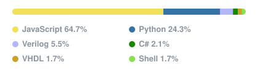

🔬 **Research:** I build sustainable computing systems that cut the carbon and water footprint of cloud, HPC, and AI.

🧭 **Exploring:** 🧬 Biology · ⚙️ ML Infra · 🎓 Education

🌐 **Website:** [lukejyk.github.io](https://lukejyk.github.io/)

💻 **Most used languages:**

  

 

  

<i>— J.R.R. Tolkien, <b>The Lord of the Rings</b></i>

