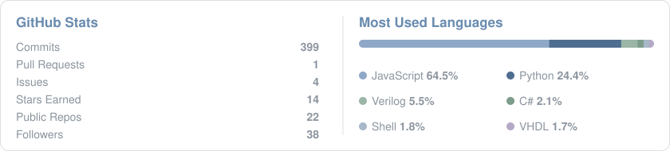

🔬 **Research:** I build sustainable computing systems that cut the carbon and water footprint of cloud, HPC, and AI. 
🧭 **Interests:** 🧬 Biology · ⚙️ ML Infra · 🎓 Education 
⌨️ **Currently:** Going mouse-free — exploring editors, terminals, and keyboard-driven workflows 
🌐 **Website:** [lukejyk.github.io](https://lukejyk.github.io/)

  

   
  <i>— J.R.R. Tolkien, <b>The Lord of the Rings</b></i>

